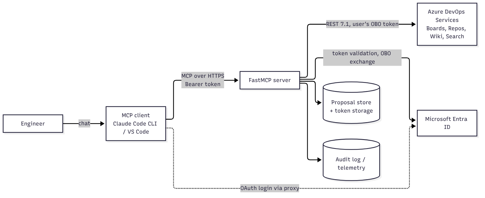

# ado-mcp

> Status: early development, build step 1 of 8 ([roadmap](docs/ARCHITECTURE.md)). Nothing here is production-ready yet.

A remote [Model Context Protocol](https://modelcontextprotocol.io) (MCP) server, built with [FastMCP](https://gofastmcp.com), that helps an AI assistant work with **Azure DevOps** work items:

- **Ticket analysis**: summary, intent, ambiguities, missing acceptance criteria.
- **Change impact assessment**: affected areas, linked PRs and code, risks, confidence.
- **Implementation planning**: ordered steps, test strategy, open questions.
- **Technical documentation**: design notes, release notes.

Two principles shape the design:

1. **Acts as you.** Every Azure DevOps call runs under the signed-in user's identity (Microsoft Entra ID, OAuth 2.0 On-Behalf-Of flow). No PATs, no shared service account. The assistant can never see or do more than you can.
2. **Human approval for every write.** Writing back to Azure DevOps is a two-step `propose` → `apply` flow, and `apply` asks you directly (MCP elicitation) to approve the exact content. The model cannot approve on your behalf.

## How it fits together



The LLM runs in the MCP client (Claude Code). The server is a deterministic layer that provides curated context, workflow prompts and gated write actions. See [docs/ARCHITECTURE.md](docs/ARCHITECTURE.md) for details.

## Getting started

> Setup instructions will be filled in as milestones land. Planned flow:

### Prerequisites

- Python 3.12+ and [uv](https://docs.astral.sh/uv/)
- Node.js (for MCP Inspector)
- An Azure DevOps organization connected to a Microsoft Entra ID tenant
- An Entra app registration (see [docs/ARCHITECTURE.md, section 4.3](docs/ARCHITECTURE.md))

### Run locally

```bash
uv sync
cp .env.example .env              # fill in tenant, client and org settings
uv run python -m ado_mcp.server   # to be confirmed
```

### Connect Claude Code

```bash
claude mcp add --transport http ado http://localhost:8000/mcp
```

On first use Claude Code opens a browser window to sign in with Entra ID.

### Inspect and debug

```bash
npx @modelcontextprotocol/inspector
```

## Configuration

| Variable | Description |
|---|---|
| `TENANT_ID` | Entra tenant ID |
| `CLIENT_ID` | App registration (client) ID |
| `CLIENT_SECRET` | Dev only; use a certificate or managed identity in Azure |
| `BASE_URL` | Public base URL of the server (OAuth redirect) |
| `ADO_ORG` | Azure DevOps organization (`myTicketOrg`) |
| `ADO_PROJECT_ALLOWLIST` | Allowed projects (`myTicketProject`) |
| `APPLICATIONINSIGHTS_CONNECTION_STRING` | Telemetry and audit log |

Secrets never go into the repository. Use a git-ignored `.env` locally and Azure Key Vault in production.

## Project layout

```
ado-mcp/
  CLAUDE.md           # guidance for Claude Code working in this repo
  docs/               # PRD, architecture, diagrams
  src/ado_mcp/        # server code (planned)
  tests/              # unit and integration tests (planned)
```

## Documentation

| Document | Answers |
|---|---|
| [docs/PRD.md](docs/PRD.md) | What and why: goals, requirements, scope decisions |
| [docs/ARCHITECTURE.md](docs/ARCHITECTURE.md) | How: components, auth flow, tools, approval workflow, ADRs, roadmap |
| [docs/diagrams/](docs/diagrams/README.md) | Diagram sources and how to re-render them |
| [CLAUDE.md](CLAUDE.md) | How Claude Code should work in this repo |

## License

TBD.
